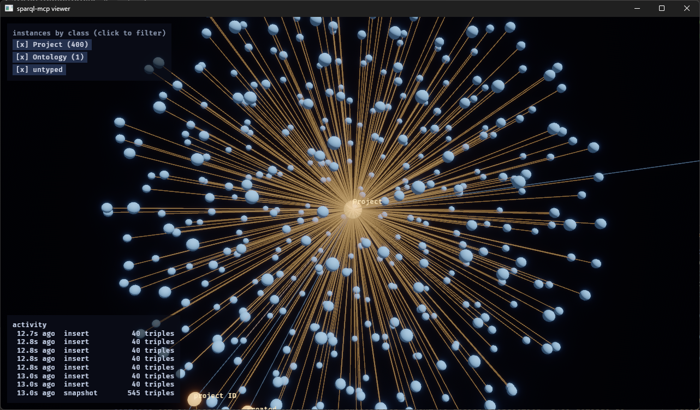

# sparql-mcp

[](https://github.com/dminier/sparql-mcp/actions/workflows/ci.yml)
[](./LICENSE)

A semantic knowledge base for AI coding agents: a single-binary MCP server
over an [Oxigraph](https://github.com/oxigraph/oxigraph) SPARQL 1.1 store.
Agents store what they learn as RDF in per-project named graphs and query it
back with SPARQL instead of re-reading files.



## Install

macOS / Linux:

```bash
curl -fsSL https://raw.githubusercontent.com/dminier/sparql-mcp/main/install.sh | bash
```

Windows: download the archive from the
[latest release](https://github.com/dminier/sparql-mcp/releases/latest), put
`sparql-mcp.exe` on your `PATH`, then run `sparql-mcp.exe install -y`.

From source: `cargo build --release && ./target/release/sparql-mcp install -y`.

`install` registers the server in every detected agent (Claude Code, Codex CLI,
Gemini CLI). Restart the agent: it spawns `sparql-mcp serve` over STDIO when
needed — there is no daemon. See [getting started](docs/getting-started.md).

## MCP tools

| Tool | Purpose |
|---|---|
| `query_sparql` | SELECT / ASK / CONSTRUCT / DESCRIBE |
| `update_sparql` | SPARQL 1.1 Update |
| `load_ontology`, `load_ontology_file` | Load Turtle into a named graph (idempotent, SHA-256) |
| `export_graph`, `list_graphs`, `stats` | Export to Turtle, introspection |
| `project_create`, `project_list`, `project_switch` | One named graph per project: `<urn:project:<slug>>` |
| `cbm_load_graph` | Import a codebase-memory-mcp code graph |
| `ingest_begin`, `ingest_batch`, `ingest_commit`, `ingest_abort`, `ingest_status` | Batch ingestion jobs: numbered, retry-safe batches, staged and committed in one step (see below) |
| `write_doc` | Write markdown under the configured docs root |
| `get_gdrive_config` | Expose the `[gdrive]` sync settings to the agent |

The `recording` feature adds `import_recording_navigations`,
`import_recording_network` and `materialize_recording` (Playwright captures).

## Write safety

Every store write is serialized by one write gate, so a long import never
blocks reads, and guarded for every caller, plugins included. See the
`[ingest]` section of [`sparql-mcp.toml`](sparql-mcp.toml).

- Internal graphs (`urn:meta`, `urn:hkb:meta:*`, `urn:sparql-mcp:jobs`,
  `urn:sparql-mcp:staging:*`) cannot be
  written through `update_sparql`, `load_ontology*` or `cbm_load_graph`.
- `LOAD`, `DROP ALL` and `CLEAR ALL` are always refused. `DROP`, `CLEAR`,
  `MOVE`/`COPY` onto a graph and `DELETE { ?s ?p ?o }` need
  `allow_destructive_updates = true`. `update_sparql` with `dry_run: true`
  reports whether a request would be refused, without running it.
- Requests and payloads are size-limited, loads are atomic, and
  `file_roots` can confine file access.
- Refusals come back as `isError` results with a JSON `code` (`write_busy`,
  `limit_exceeded`, `graph_protected`, `destructive_update_forbidden`,
  `path_outside_roots`, …) so an agent can react to them.

## Batch ingestion

For loads that need many calls (tens of thousands of triples and up), use an
ingestion job instead of looping over `load_ontology`:

1. `ingest_begin`: returns a `job_id` and the limits to size batches by. By
   default the job is *staged*: nothing is visible until the commit. Use
   `mode: "direct"` for large append-only loads, `replace: true` to replace the
   target graph's contents.
2. `ingest_batch` with `seq` 1, 2, 3, … and N-Triples `data` (2,000–5,000 triples,
   at most 512 KiB). Re-send the **same `seq`** after any timeout or error:
   a batch that already landed returns `duplicate: true` with its original
   counts, and is stored once. A batch with a syntax error is refused whole;
   fix it and re-send it under the same `seq`.
3. `ingest_commit`: the staged triples move into the target in one transaction.
   The reply lists `new_subjects`, which can be passed to `viewer_show`.
   `ingest_abort` discards the job instead.

`ingest_status` shows a job's received batches (as ranges), so a restarted
session knows which batches to re-send. Blank nodes written `_:x` are the same
node in every batch of a job. The job ledger is in the protected graph
`urn:sparql-mcp:jobs`. Limits are in the `[ingest]` section.

## CLI

```text
sparql-mcp serve              run as an MCP STDIO server
sparql-mcp install            register the server in detected agent configs
sparql-mcp stats              triple and graph counts
sparql-mcp reload-ontology    re-load ontology/ into the store
sparql-mcp load-file --path   load a Turtle / N-Triples / RDF-XML file
sparql-mcp code-import --db   import a codebase-memory-mcp SQLite graph
```

Configuration: [`sparql-mcp.toml`](sparql-mcp.toml).

## Live 3D viewer

`sparql-mcp-viewer` shows the active project graph in 3D and grows it as the
agent writes. Enable `[viewer]` in `sparql-mcp.toml`, then see
[its README](crates/sparql-mcp-viewer/README.md).

## Claude Code plugin

The `kb-workbench` plugin adds the skills that teach an agent to ingest,
audit and render a knowledge base with this server:

```text
/plugin marketplace add dminier/sparql-mcp
/plugin install kb-workbench@sparql-mcp
```

## Contributing

```bash
cargo fmt --all
cargo clippy --all-targets --all-features -- -D warnings
cargo test --all --all-features
```

Architecture and conventions: [AGENTS.md](AGENTS.md). The write path and ingestion
jobs have a benchmark that sets their limits: [docs/benchmarks/ingest.md](docs/benchmarks/ingest.md).

## License

MIT — see [LICENSE](LICENSE).
